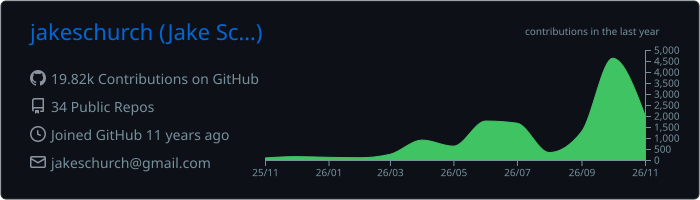
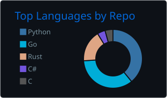
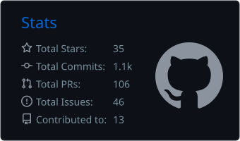

# Hi, I'm Jake 

Platform Engineer with a full-stack background. I like making teams faster: build systems, CI, infrastructure, and the dev tooling around them.

- 🔒 Building the future of trust for Advisory & Audit at [Fieldguide](https://www.fieldguide.io/)
- 💚 Scaling engineering orgs through platform work
- 🛠️ Into Nix, Kubernetes, and Neovim
- 🌍 Based in Boston, MA

## Stats

  

  
  

## Links

&nbsp;<a href="https://github.com/jakeschurch/dots">My dotfiles</a> (Nix, Neovim, and the rest of my setup)
